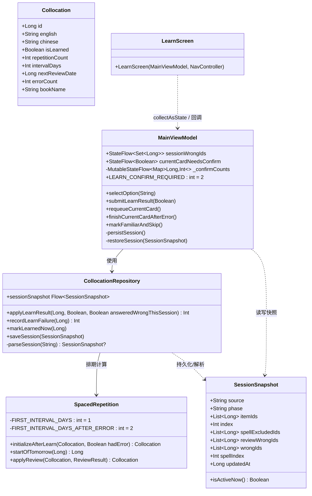
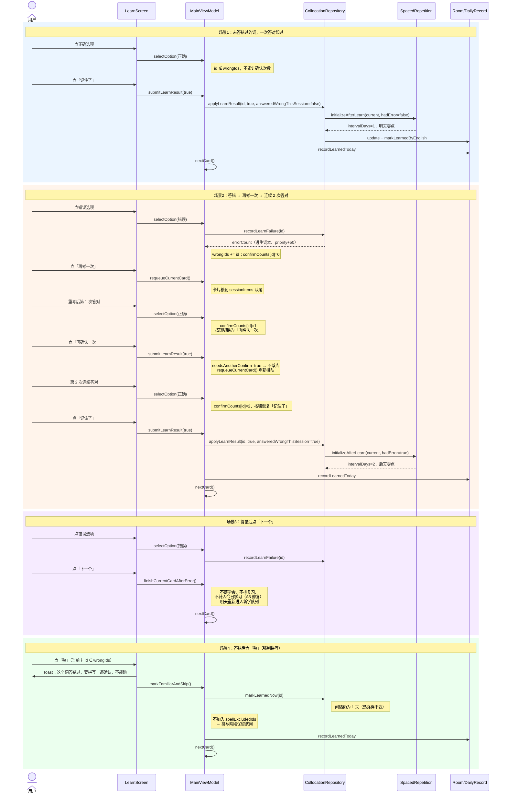
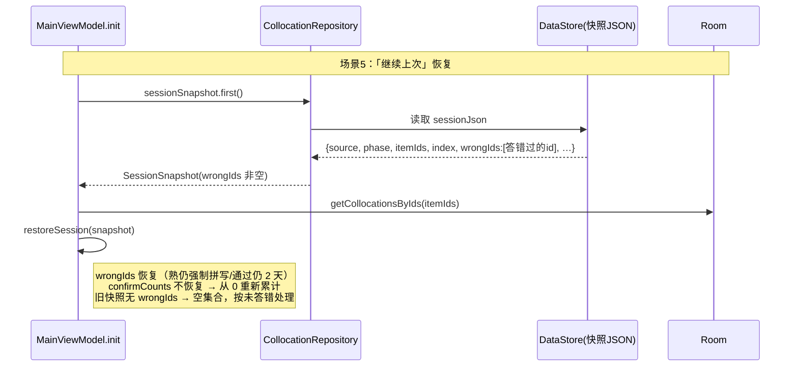
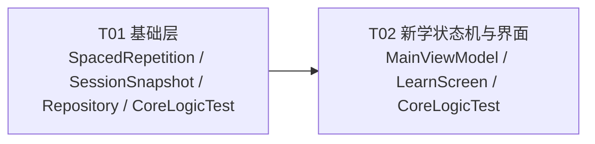

# 搭配记忆 · 新学算法增量设计（方案 3）

> 产出：架构师 高见远 ｜ 主理人：齐活林 ｜ 日期：2026-10-14
> 状态：待用户批准后进入实现（T01 → T02）
> 本文档为设计稿，未修改任何源码文件。

方案 3 = ① 连续答对 2 次才算学会（答错清零重计）② 答错过的词强制拼写（「熟」也不能跳）③ 答错过的词首次复习间隔 2 天起。

代码事实均已对照源码核实（行号为近似值，以函数名为准）：`submitLearnResult`(L965)、`selectOption`(L856)、`requeueCurrentCard`(L881)、`finishCurrentCardAfterError`(L934)、`markFamiliarAndSkip`(L1011)、`SpacedRepetition.initializeAfterLearn`(L120)、`dueAt`(L36)、`applyLearnResult`(L175)、`recordLearnFailure`(L156)、`markLearnedNow`(L210)、`SessionSnapshot`、`parseSession`(L798)、`CoreLogicTest`(16 用例)、`tools/run_tests.sh`。已核实 `selectOption/submitLearnResult/markFamiliarAndSkip/finishCurrentCardAfterError/requeueCurrentCard` **仅 LearnScreen 调用**，复习流程不受影响；`initializeAfterLearn/applyLearnResult` 各只有一个上游调用点。

---

## 一、实现方案

### 1.1 核心思路

缺陷根源：「记住了」与「答错后重考答对」共用 `submitLearnResult(true)` → `applyLearnResult(id, true)` → `initializeAfterLearn()`，无差别。修复采取**最小变更**：全部改造收敛在「ViewModel 会话状态机 + 三个函数加参数」，**不加新类、不加新依赖、不动 DAO、不动数据库 schema**。

新增两个**会话级**（按词条 id 记录）状态：

| 状态 | 类型 | 作用 | 是否持久化 |
|---|---|---|---|
| `_sessionWrongIds` | `Set<Long>` | 本次会话答错过的词（驱动：确认机制、强制拼写、2 天间隔） | **是**（快照新增 `wrongIds` 字段） |
| `_confirmCounts` | `Map<Long, Int>` | 答错词的连续答对次数 | 否（恢复后从 0 重新累计，见 A2） |

### 1.2 新学卡片算法状态机

每张卡（按 id）在会话内处于：`clean`（未答错过）→ `errored(count=0/1)` → 终态 `passed`（落库学会）/ `dropped`（点「下一个」，不落库）。

| 当前状态 | 事件 | 动作 | 次态 |
|---|---|---|---|
| clean | 选错 | `recordLearnFailure`（既有：errorCount+1、进生词本、priority+50）；wrongIds+=id；count=0 | errored(0) |
| clean | 选对→点「记住了」 | `applyLearnResult(id, true, answeredWrongThisSession=false)` → intervalDays=**1** | passed |
| clean | 看答案→点「记住了/记错了」 | 同现有行为，interval=**1**（偷看不算答错，见 A6） | passed |
| errored(0) | 选错 | `recordLearnFailure`；**count 归零** | errored(0) |
| errored(0) | 选对 | **count=1**（selectOption 内累计）；按钮变「再确认一次」 | errored(1) |
| errored(0/1) | 点「再确认一次」 | 不落库、不推进；`requeueCurrentCard()` 卡片去队尾 | errored(不变) |
| errored(1) | 选对 | **count=2**；按钮恢复「记住了」 | errored(2) |
| errored(2) | 点「记住了」 | `applyLearnResult(id, true, answeredWrongThisSession=true)` → intervalDays=**2** | passed |
| errored(任意) | 点「熟」 | `markLearnedNow`（interval=**1**，不变）+ recordLearnedToday；**不加入 spellExcludedIds**（强制拼写）+ Toast 告知原因 | passed(需拼写) |
| errored(任意) | 点「记错了」 | `applyLearnResult(id, false, hadError=true)` → interval=**2**、errorCount+1（既有分支） | passed |
| errored(任意) | 看答案→点「记住了」 | **count 不变**（偷看不能攒次数，防连看两次绕过确认）；count<2 → 再排队；count≥2 → 通过（该分支实际不可达，见说明） | 不变 / passed |
| 任意 | 答错后点「下一个」 | 仅 `nextCard()`：**不落学会、不排复习、不计入今日学习**（A3 缺口修复） | dropped |

**边界情况：**
- **会话恢复**：`wrongIds` 随快照恢复（恢复后「熟」仍强制拼写、通过仍给 2 天间隔）；`confirmCounts` 不恢复，恢复后重新累计 2 次。恢复时当前卡以「未揭晓」状态呈现（现有 restoreSession 即不还原 isAnswerRevealed），用户重答。
- **重复答错**：每次答错 count 归零、wrongIds 保持、errorCount 累加（既有逻辑不动）。
- **整组全部答错**：全部走「再考一次」循环，每张卡需 2 次连续答对；requeue 移队尾保证不丢卡，会话直到逐张 passed/dropped/熟 才完。
- **跨词本同名词**：wrongIds/count 按**行 id** 记录，不按 english；`markLearnedByEnglish` 跨词本同步行为不变。
- **快照 TTL 12h 过期**：不恢复，wrongIds 随之废弃，符合「本次会话」语义。
- **旧快照（无 wrongIds 字段）**：`parseSession` 逐字段兜底读成空列表 → 按未答错处理，安全降级不崩。
- **出口保证**：确认循环中的卡始终有「熟」「记错了」两个出口，不会把用户卡死。

### 1.3 三个需求点的落点

1. **连续答对 2 次**：`selectOption` 选对时若 id ∈ wrongIds 则 count+1；`submitLearnResult(true)` 入口用 `needsAnotherConfirm(wrong, count)` 把关，未满 2 次直接 `requeueCurrentCard()` 不落库。UI 按钮文案由 `currentCardNeedsConfirm` 派生。
2. **强制拼写**：`markFamiliarAndSkip` 中仅当 `id ∉ wrongIds` 才加入 `_spellExcludedIds`；LearnScreen 点「熟」时若当前卡 ∈ wrongIds 弹 Toast 说明原因（仍执行标记学会）。
3. **首次间隔 2 天**：`applyLearnResult` 新增参数 `answeredWrongThisSession`，透传 `initializeAfterLearn(hadError)`：`intervalDays = if (hadError) 2 else 1`，`nextReviewDate = dueAt(now, interval)`（后天零点，自然日口径）；「熟」路径 `markLearnedNow` 不动（保持 1 天）。

---

## 二、文件清单（共 6 个，无新增文件、无新增依赖、无配置文件变更）

| # | 路径 | 动作 | 改什么（一句话） |
|---|---|---|---|
| 1 | `app/src/main/java/com/example/collocationmemory/util/SpacedRepetition.kt` | 修改 | `initializeAfterLearn` 增加 `hadError: Boolean = false` 参数与两个间隔常量，控制 intervalDays=1/2 |
| 2 | `app/src/main/java/com/example/collocationmemory/data/local/SessionSnapshot.kt` | 修改 | 新增 `wrongIds: List<Long> = emptyList()` 字段（默认空，兼容旧快照） |
| 3 | `app/src/main/java/com/example/collocationmemory/data/repository/CollocationRepository.kt` | 修改 | `applyLearnResult` 增加 `answeredWrongThisSession: Boolean = false` 并透传；`parseSession` 增加 `wrongIds = longList("wrongIds")` 兜底读取 |
| 4 | `app/src/main/java/com/example/collocationmemory/ui/viewmodel/MainViewModel.kt` | 修改 | 新增 `_sessionWrongIds`/`_confirmCounts` 与派生流；改造 `selectOption`/`submitLearnResult`/`markFamiliarAndSkip`/`finishCurrentCardAfterError`；快照持久化/恢复/三处重置同步 |
| 5 | `app/src/main/java/com/example/collocationmemory/ui/screens/LearnScreen.kt` | 修改 | 「记住了」按钮按 `currentCardNeedsConfirm` 切换「再确认一次」文案+点击 Toast；「熟」被拦截时 Toast 告知原因 |
| 6 | `app/src/test/java/com/example/collocationmemory/CoreLogicTest.kt` | 修改 | 新增 `initializeAfterLearn(hadError)` 排期用例、快照 wrongIds 往返用例、`needsAnotherConfirm` 纯函数用例 |

---

## 三、接口与数据变化

### 3.1 签名变化（均有默认值，旧调用方式编译不变）

```kotlin
// util/SpacedRepetition.kt
private const val FIRST_INTERVAL_DAYS = 1                  // 普通词首次间隔
private const val FIRST_INTERVAL_DAYS_AFTER_ERROR = 2      // 答错过的词首次间隔 2 天起
fun initializeAfterLearn(collocation: Collocation, hadError: Boolean = false): Collocation
// 内部：val intervalDays = if (hadError) FIRST_INTERVAL_DAYS_AFTER_ERROR else FIRST_INTERVAL_DAYS
//       nextReviewDate = dueAt(now, intervalDays)

// data/repository/CollocationRepository.kt
suspend fun applyLearnResult(
    collocationId: Long,
    remembered: Boolean,
    answeredWrongThisSession: Boolean = false   // 新增：本次会话是否答错过
): Int
// 内部：SpacedRepetition.initializeAfterLearn(current, hadError = answeredWrongThisSession)

// data/local/SessionSnapshot.kt
data class SessionSnapshot(
    …,
    val wrongIds: List<Long> = emptyList(),     // 新增：本次会话答错过的词
    …
)
```

### 3.2 MainViewModel 新增状态与方法形态

```kotlin
// 公开状态（LearnScreen 消费）
val sessionWrongIds: StateFlow<Set<Long>>                    // 熟拦截判断用
val currentCardNeedsConfirm: StateFlow<Boolean>              // 按钮文案用
// 派生：combine(_sessionItems, _currentIndex, _sessionWrongIds, _confirmCounts) { … needsAnotherConfirm(…) }
//       .stateIn(viewModelScope, SharingStarted.Eagerly, false)   // 与 spellItems 同一模式

// 私有状态
private val _sessionWrongIds = MutableStateFlow<Set<Long>>(emptySet())
private val _confirmCounts = MutableStateFlow<Map<Long, Int>>(emptyMap())

// 文件内顶层纯函数（放 MainViewModel.kt 末尾区域，internal 供单测；VM 依赖 Repository 测不动，规则抽成纯函数）
internal fun needsAnotherConfirm(answeredWrongThisSession: Boolean, consecutiveCorrect: Int): Boolean =
    answeredWrongThisSession && consecutiveCorrect < MainViewModel.LEARN_CONFIRM_REQUIRED

// companion object 新增
const val LEARN_CONFIRM_REQUIRED = 2
```

### 3.3 类图



---

## 四、调用流程

### 4.1 新学卡片交互时序（场景 1–4）



### 4.2 会话恢复时序（场景 5）



---

## 五、待明确事项（A1–A4 + 新发现）

| # | 事项 | 建议默认值（已按此设计） |
|---|---|---|
| A1 | 连续答对计数作用范围 | **仅答错过的词**（需求原文）；未答错词维持一次答对即过 |
| A2 | 计数是否入快照 | **confirmCounts 不持久化**，恢复后重新累计；**wrongIds 持久化**（保证强制拼写/2 天间隔跨恢复一致）。影响：「继续上次」时确认中的卡需重新答对 2 次 |
| A3 | 答错后点「下一个」的归宿 | **记为未学会、不排复习、不计入今日学习**，明天重新进入新学队列（errorCount/生词本/priority 保留）。影响：当日「今日学习」数字比旧版本小——这是口径修正（未学会不计入），需在验收说明中确认 |
| A4 | 强制拼写与 `_spellExcludedIds` 的交互 | 答错词点「熟」时**不加入** `_spellExcludedIds`；拼写错误沿用 `submitSpellResult` 既有逻辑（归零+明天重排+进生词本） |
| A5 | 「看答案」后点「记住了」是否算一次答对 | **不算**（偷看不能攒确认次数，否则连看两次即绕过）；确认循环有「熟/记错了」出口，不会卡死。若产品认为应放行，改为 count+1 即可（一行） |
| A6 | 未答错词「看答案+记错了」 | 维持既有行为 interval=1（未发生答错选择，不进 wrongIds）；答错词走该分支则 hadError=true → interval=2 |
| A7 | `submitLearnResult` 的 `alreadyRecorded` 分支（答错后点记住了） | 当前 UI 不可达（答错后只有「再考一次/下一个」）；保留原结构仅加参数，不做行为变更 |
| A8 | 跨词本同名行 `nextReviewDate=0` 学会即到期 | **既有行为，本次不改**；仅提示知晓（`markLearnedByEnglish` 只置 isLearned） |
| A9 | 2 天间隔的口径 | 自然日：`dueAt(now, 2)`=后天零点；DAO 毫秒精度无需改 |
| A10 | Toast/按钮文案措辞 | 建议「再确认一次」；熟拦截 Toast「这个词答错过，要拼写一遍确认，不能跳」；工程师可微调，原则（短句/信息优先/不用热词）不变 |

---

## 六、所需依赖包

**无新增依赖**（不引入任何第三方包）。复用现有：Jetpack Compose/Material3、Room、DataStore、kotlinx-coroutines（combine/StateFlow）、Gson、JUnit4（单测）。

---

## 七、任务列表（2 个任务；增量改动仅触 6 文件，无配置文件/入口文件可动，T01 承担"基础设施"角色——算法+模型+仓库签名，T02 为功能层）

### T01（P0）基础层：排期参数化 + 快照字段 + 仓库签名 + 单元测试
- **Source Files**：
  - `app/src/main/java/com/example/collocationmemory/util/SpacedRepetition.kt`
  - `app/src/main/java/com/example/collocationmemory/data/local/SessionSnapshot.kt`
  - `app/src/main/java/com/example/collocationmemory/data/repository/CollocationRepository.kt`
  - `app/src/test/java/com/example/collocationmemory/CoreLogicTest.kt`
- **Dependencies**：无（首个任务）
- **内容**：`initializeAfterLearn(hadError)` + 两个常量；`SessionSnapshot.wrongIds` + `parseSession` 兜底读取；`applyLearnResult(answeredWrongThisSession)` 透传；对应单测。
- **验收标准**：
  1. `initializeAfterLearn(item(), hadError=true)` → `intervalDays=2` 且 `nextReviewDate`=后天零点（与 `startOfTomorrow()+24h` 偏差 <2s）；`hadError=false`/缺省 → `intervalDays=1`，既有 16 用例全绿；
  2. `SessionSnapshot` 含 `wrongIds`，Gson 往返不丢（新增用例）；`parseSession` 对缺 `wrongIds` 的旧 JSON 返回空列表；
  3. `applyLearnResult` 新参数默认 false，既有两处调用编译不变；传 true 时 `initializeAfterLearn` 收到 `hadError=true`；
  4. `tools/run_tests.sh` 全绿；无新增依赖；无 API 26 以上新 API。

### T02（P0）新学状态机 + 界面适配 + 测试补充
- **Source Files**：
  - `app/src/main/java/com/example/collocationmemory/ui/viewmodel/MainViewModel.kt`
  - `app/src/main/java/com/example/collocationmemory/ui/screens/LearnScreen.kt`
  - `app/src/test/java/com/example/collocationmemory/CoreLogicTest.kt`
- **Dependencies**：T01（内部顺序：先 VM 后 UI，UI 依赖 VM 新状态，不可并行）
- **内容**：VM 新增 wrongIds/confirmCounts/派生流/纯函数；改造四个入口方法；快照持久化/恢复/`startLearnSession`/`startReviewSession`/`endSession` 三处重置；LearnScreen 按钮文案与两处 Toast；`needsAnotherConfirm` 单测。
- **验收标准**：
  1. 回归：未答错词选对→「记住了」一次通过，intervalDays=1；
  2. 答错词：选错→wrongIds/errorCount/生词本（既有）；「再考一次」排队；重考后第 1 次答对→按钮变「再确认一次」、点击后卡片重新排队且**不落库不推进**；第 2 次连续答对→「记住了」→ intervalDays=2；中途再答错→计数清零重新累计；
  3. 答错词点「熟」：仍标记学会并排明天复习（interval=1），但**不进 spellExcludedIds**（拼写阶段保留），且界面 Toast 说明原因；
  4. 答错后点「下一个」：不标记学会、不排复习、**DailyRecord.learnedCount 与 learnedIds 均不含该词**；该词明天重新出现在新学队列；
  5. 会话恢复：wrongIds 随快照恢复（恢复后「熟」仍强制拼写、通过仍 2 天）；confirmCounts 不恢复；旧快照（无 wrongIds）恢复不崩、按未答错处理；
  6. 「看答案」后点「记住了」对答错词不计入确认次数；
  7. `tools/run_tests.sh` 全绿；主线与 `-PlegacyCompat` 均编译通过；无新增依赖；
  8. 真机/模拟器手工验收：一整组混合场景（含全部答错、中途退出→继续上次、答错词熟拦截后拼写阶段可见）。
- **批量完成标注**：T01→T02 强依赖，一人顺序完成；T02 内部 VM→UI 分两步迭代。

---

## 八、跨文件共享约定

- **排期唯一入口**：所有复习排期必须走 `SpacedRepetition`（`dueAt`/`startOfToday`/`startOfTomorrow`），禁止在 VM/Repository 直接算 24 小时；时间戳统一「本地时区零点 + 毫秒」。
- **写库模式**：先 `getById` 读当前值再 `copy` 更新，禁止用界面快照整条写回（既有约定，本次所有改动遵守）。
- **快照解析**：新增字段必须同步 `parseSession` 的逐字段兜底读取；**禁止**改用 Gson 直接反序列化快照（Unsafe 绕过 Kotlin 默认值，旧 JSON 会得 null）。
- **命名**：私有 `MutableStateFlow` 带 `_` 前缀、公开 `StateFlow` 不带；算法阈值放 `SpacedRepetition.companion`，会话规则阈值放 `MainViewModel.companion`；会话级按 id 记录的状态用 `Set<Long>`/`Map<Long, Int>`。
- **注释与文案**：全部中文；注释解释「为什么」（沿用现有风格）；Toast/按钮短句、信息优先、不用网络热词（参照 `ErrorHint` 注释原则）。
- **兼容约束**：不使用 API 26 以上新 API（兼容包与主线同 versionCode）；不引入新依赖；不动发版流程文件（manifest.json/操作单/changelog）。

---

## 九、风险与回归影响面

1. **快照兼容（低危）**：旧快照无 `wrongIds` → `parseSession` 兜底空列表 → 恢复后按未答错处理（不强制拼写、间隔 1、一次答过），不崩。新快照字段新增不影响 `isActiveNow` TTL 语义。
2. **跨词本同步**：2 天间隔只写当前行；其他词本同名行经 `markLearnedByEnglish` 仅置 `isLearned=1`、`nextReviewDate` 保持 0（既有行为，学会即在其词本到期，A8，本次不改）。
3. **首页「继续上次」**：恢复路径新增 wrongIds 还原，入口卡片与导航逻辑不变；confirmCounts 不恢复带来的「恢复后需重新累计 2 次」已在 A2 说明。
4. **今日统计口径（需产品知晓）**：`finishCurrentCardAfterError` 不再计入「今日学习」→ 常用「下一个」的用户当日 learnedCount/累计学习会比旧版本小；属口径修正（未学会不计入），验收时需确认接受。
5. **`finishCurrentCardAfterError` 缺口修复的影响**：该词修复前后都未落学会、明天重进新学队列；唯一变化是统计口径。注意：该词仍留在 sessionItems 中（非熟），拼写阶段仍会出现——既有行为不变。
6. **拼写阶段集合变大**：答错词被「熟」标记后不再排除 → `spellItems` 可能比旧版本多；`nextCard()` 的「整组都熟则 endSession」分支天然兼容（排除集合变小不会误判）。
7. **复习流程零影响**：已核实五个入口方法仅 LearnScreen 调用；`reviewWrongIds`/`spellExcludedIds`/`submitReviewResult`/`submitSpellResult` 逻辑未动。
8. **构建**：无新 API/新依赖，`-PlegacyCompat` 无需额外适配；产物同名 `app-release.apk`，构建后按既有流程立即归档（实现完成后收尾，不在本设计范围）。

---

## 十、任务依赖图


